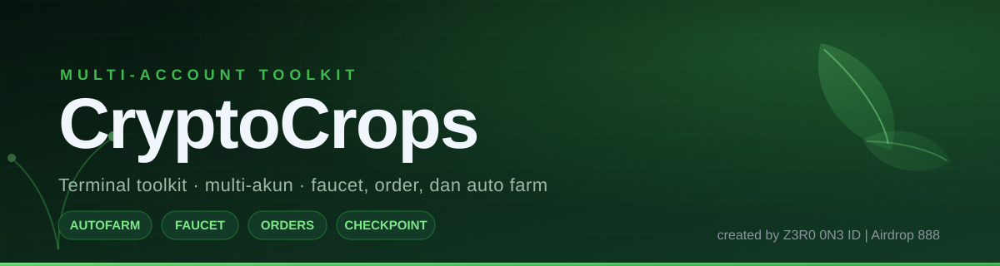
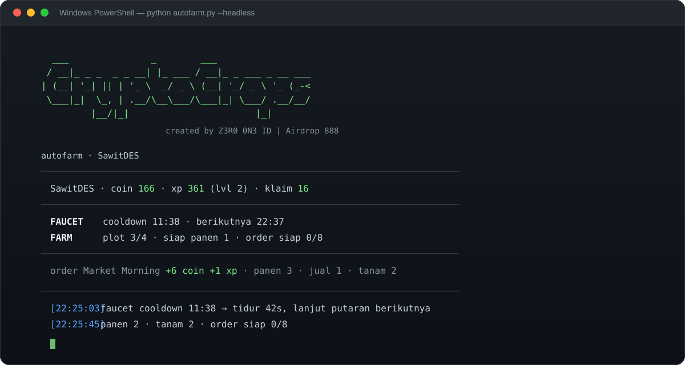

# CryptoCrops Bot

<p align="center">
  
</p>

<p align="center">
  
  
  
  
</p>

<p align="center">
  Toolkit terminal untuk mengelola beberapa akun <a href="https://cryptocrops.net">cryptocrops.net</a> sekaligus —<br>
  klaim faucet otomatis, kirim farm order, panen/jual/tanam, dan checkpoint OCR dari satu perintah.
</p>

---

## Daftar isi

- [Fitur](#fitur)
- [Instalasi](#instalasi)
- [Format cookies.txt](#format-cookiestxt)
- [Kelola akun](#kelola-akun)
- [Faucet](#faucet)
- [Orders](#orders)
- [Missions](#missions)
- [Auto farm](#auto-farm)
- [Estimasi pendapatan](#estimasi-pendapatan)
- [Checkpoint](#checkpoint)
- [Client API](#client-api)
- [Struktur proyek](#struktur-proyek)
- [Troubleshooting](#troubleshooting)
- [Catatan operasional](#catatan-operasional)

---

## Fitur

| Modul | Fungsi |
|---|---|
| `login.py` | Tambah / impor / ekspor akun, tes cookie, tulis `cookies.txt` otomatis |
| `faucet_run.py` | Klaim faucet lewat browser asli (Turnstile) dengan cooldown otomatis |
| `orders.py` | Lihat order aktif, preview hadiah, fulfill, reroll |
| `client.py` | Klien API mentah (`requests`) + `missions --claim` |
| `autofarm.py` | Satu loop: checkpoint → faucet → order → harvest/sell/plant → klaim misi |
| `checkpoint.py` | Selesaikan checkpoint anti-bot pakai OCR `ddddocr` |
| `earnings.py` | Hitung pendapatan HC/USD + berapa akun untuk target tertentu |
| `ui.py` | Banner, warna, dan dashboard terminal satu frame |

Multi-akun penuh: satu `accounts.json`, satu `cookies.txt` untuk akun aktif,
dan `autofarm.py --all-accounts` untuk menjalankan semuanya bergiliran.

---

## Instalasi

```UCRT64
git clone https://github.com/Krismianto/cryptocrops-bot-fix.git
cd cryptocrops-Bot

python -m venv .venv
source .venv/Scripts/activate

pip install -r requirements.txt
```

Kebutuhan browser (Turnstile) dipasang sekali di venv terpisah oleh
`faucet_run.py`; kalau ingin manual:

```powershell
pip install camoufox[geoip] patchright
python -m camoufox fetch
```

`faucet_run.py` dan `autofarm.py` tetap bisa dijalankan dari Python sistem —
keduanya otomatis berpindah ke venv browser yang tepat (override: env `CC_PY`).

---

## Format cookies.txt

Dua cookie yang dipakai: `cc_registration_v1` (id tamu) dan `cc_session_v1` (sesi).
Ambil dari DevTools → **Application → Cookies → https://cryptocrops.net**.

### Satu akun

```text
cc_registration_v1=0de0566b-6a14-4b97-8ecf-7f759782bd2a.1792480912945.36c769a8882947a0fe0cad92afbf67e30d036af442955dc7a1382dfd46882a0b
cc_session_v1=xtoNAwYXNTli-2QIFL16MtPxiyI5TfS6cG83uP9K-y8
```

### Banyak akun

Satu baris = satu akun, urutan **registration | session**:

```text
cc_registration_v1|cc_session_v1
cc_registration_v1|cc_session_v1
```

Contoh nyata:

```text
0de0566b-6a14-4b97-8ecf-7f759782bd2a.1792480912945.36c7…|xtoNAwYXNTli-2QIFL16MtPxiyI5TfS6cG83uP9K-y8
0de0566b-6a14-4b97-8ecf-7f759782bd2a.1792480912945.aa11…|ZkQ7hS2pLm4nR8tV1wX6yB0cD3eF5gH9jK
```

Format lain yang tetap diterima parser:

| Bentuk | Contoh |
|---|---|
| Satu blok akun | `cc_registration_v1=…` lalu `cc_session_v1=…` |
| `name=value` dipisah `\|` | `cc_registration_v1=…\|cc_session_v1=…` |
| Header cookie utuh | `cc_session_v1=…; cc_registration_v1=…; Path=/` |
| Baris Netscape | `cryptocrops.net<TAB>FALSE<TAB>/<TAB>TRUE<TAB>…` |
| Token mentah | `xtoNAwYXNTli-2QIFL16MtPxiyI5TfS6cG83uP9K-y8` |

Baris yang diawali `#` diabaikan, jadi komentar aman ditulis di file.
Parser dan penulis format ada di [`cookiefile.py`](cookiefile.py); cek isi file dengan:

```powershell
python cookiefile.py cookies.txt
```

---

## Kelola akun

Akun disimpan di `accounts.json` (nama diambil otomatis dari display name server).
Setiap kali akun aktif berubah, `cookies.txt` ditulis ulang dalam format di atas.

```powershell
python login.py                  # tempel cookie, Enter
python login.py --clip           # ambil langsung dari clipboard
python login.py --import cookies.txt   # impor banyak akun + verifikasi
python login.py --export backup.txt    # ekspor: reg|session per baris
python login.py --list           # daftar akun, * = aktif
python login.py --use SawitDES   # ganti akun aktif
python login.py --remove SawitDES
python login.py --check          # tes semua cookie + saldo
```

Cookie diverifikasi ke `/api/bootstrap` sebelum disimpan; yang 401 dilewati.
Impor massal melaporkan ringkasan `selesai: 3/5 akun tersimpan`.

---

## Faucet

```powershell
python faucet_run.py                        # akun aktif, tunggu cooldown, klaim
python faucet_run.py --account SawitDES     # akun tertentu
python faucet_run.py --headless             # tanpa jendela
python faucet_run.py --headless --loop      # klaim terus mengikuti cooldown
python faucet_run.py --json                 # satu baris JSON (untuk parsing)
python faucet_run.py --dry-run              # berhenti sebelum klik klaim
```

Alur: buka `/faucet/` → klik widget Turnstile → `js-click` tombol klaim →
response `POST /api/earn/faucet` dicatat. Kalau tab keburu tertutup, status
dicek ulang lewat bootstrap (`claim_count` naik = klaim sah).

```
  selesai dalam 64.5s
  ✓ klaim berhasil
    +10 coin · +1 xp · saldo 166
    berikutnya 14:16 (22:37)
```

---

## Orders

```powershell
python orders.py                # daftar order + kebutuhan produce
python orders.py --preview 2    # rincian hadiah & produce yang dipakai
python orders.py --fulfill      # kirim semua order yang siap
python orders.py --reroll 3     # reroll slot 3 (kuota harian)
```

Endpoint: `GET /api/orders/preview`, `POST /api/orders/fulfill`,
`POST /api/orders/reroll` dengan body `{idempotency_key, order_id}`.

Order memakai produce di barn (pantry dulu, baru fresh — fresh yang terpakai
berarti kehilangan Harvest Points). Karena itu `autofarm.py`:

- mengirim order yang **siap** sebelum menjual panen;
- menyisakan produce yang dibutuhkan order aktif, jadi yang dijual hanya kelebihannya.

---

## Missions

Daily & Weekly Missions memberi Harvest Pass XP (kadang plus fertilizer) tanpa
biaya coin. Daftar misi ikut di `/api/bootstrap` (`farm.missions`), klaimnya
`POST /api/missions/claim`. Kontrak lengkap: [`docs/analysis-6-missions.md`](docs/analysis-6-missions.md).

```powershell
python client.py missions          # status semua misi
python client.py missions --claim  # klaim yang complete & belum claimed
```

```
mission_id                        period    progress  status
daily-harvest-5                   daily        25/25  claimed
daily-order-1                     daily          1/5  progress
weekly-harvest-25                 weekly     125/125  READY
weekly-sell-25                    weekly     125/125  READY
...
2 misi siap diklaim
```

`autofarm.py` mengklaim otomatis di akhir tiap putaran — setelah
harvest/jual/order, karena aksi itu bisa menuntaskan misi baru. Output-nya
menyatu di baris aktivitas:

```
misi Full Fields +150 pass xp · misi Produce Merchant +200 pass xp
```

Matikan dengan `--no-missions`. Misi offerwall / shortlink / PTC tidak
diotomasi karena butuh interaksi manusia.

---

## Auto farm

```powershell
python autofarm.py --headless                 # akun aktif, loop
python autofarm.py --headless --once          # satu putaran
python autofarm.py --account SawitDES         # akun tertentu
python autofarm.py --all-accounts --headless  # semua akun bergiliran
python autofarm.py --no-faucet                # farm + order saja
python autofarm.py --no-orders                # farm saja
python autofarm.py --no-missions              # lewati klaim misi
python autofarm.py --plain                    # log polos
python autofarm.py --log-history 3            # simpan 3 baris aktivitas
python autofarm.py --align left               # rata kiri
python autofarm.py --dry-run --once           # rencana saja, tanpa aksi
```

Satu putaran per akun:

1. **checkpoint** — kalau `checkpoint_due`, gambar challenge diunduh dan dipecahkan OCR
2. **faucet** — kalau `available`, dipanggil lewat subprocess ke venv browser
3. **orders** — order `ready` dikirim ke `/api/orders/fulfill`
4. **farm** — harvest crop matang → jual kelebihan → tanam ulang plot kosong
   (seed habis / `NO_AVAILABLE_SEED_COPY` dilewati, bukan error)
5. **misi** — semua misi `complete` yang belum `claimed` diklaim
   (`POST /api/missions/claim`), hasilnya masuk ke baris aktivitas

Dashboard default (satu frame, tidak scroll):

<p align="center">
  
</p>

<details>
<summary>Versi teks (tanpa gambar)</summary>

```text
  ___               _        ___
 / __|_ _ _  _ _ __| |_ ___ / __|_ _ ___ _ __ ___
| (__| '_| || | '_ \  _/ _ \ (__| '_/ _ \ '_ (_-<
 \___|_|  \_, | .__/\__\___/\___|_| \___/ .__/__/
         |__/|_|                       |_|
           created by Z3R0 0N3 ID | Airdrop 888

autofarm · SawitDES
────────────────────────────────────────────────────────────
  SawitDES · coin 166 · xp 361 (lvl 2) · klaim 16
────────────────────────────────────────────────────────────
  FAUCET  cooldown 11:38 · berikutnya 22:37
  FARM    plot 4/4 · siap panen 0 · order siap 0/8 · panen 02:14
────────────────────────────────────────────────────────────
  order Market Morning +6 coin +1 xp · panen 3 · jual 1 · tanam 2
```

</details>

Jeda antar putaran menyesuaikan: kalau ada crop matang dalam 40 detik, putaran
berikutnya 42 detik kemudian. `--interval` hanya batas atas; faucet dicek ulang
paling lambat 90 detik setelah waktunya.

Baris `FAUCET` dan `FARM` sama-sama punya hitungan mundur (`cooldown 11:38`,
`panen 02:14`). Kalau angkanya berjalan, loop-nya memang hidup — tidak ada
aksi panen/jual/tanam hanya berarti belum ada yang bisa dikerjakan.

---

## Estimasi pendapatan

```powershell
python earnings.py                          # target $10/hari
python earnings.py --target 50 --unit week
python earnings.py --unit once --fleet 20   # berapa hari untuk $10 sekali
python earnings.py --uptime 1 --hours 24    # skenario ideal
python earnings.py --coins 5000             # simulasi kalau saldo coin naik
```

Angka diambil dari server, bukan tebakan: seed terbaik yang **benar-benar bisa
dipakai** (sudah di inventory atau harganya ≤ saldo coin), nilai poin dari
`pool.estimatedHarvestCredits / total_points`, dan `creditsPerUsd` (10.000 HC =
$1).

Contoh nyata (4 plot, seed radish 144 pts/jam, uptime 85%):

```
per akun    : 11.750 pts/hari -> 3.713 HC -> $0.3713/hari
per minggu  : $2.60 · per bulan $11.14

target $10.00 per hari
  linear    : 27 akun (dilusi diabaikan)
  realistis : 34 akun (poin kamu ikut masuk pool)
```

Jawaban singkat "butuh berapa akun untuk $10":

| Target | Akun (realistis) |
|---|---|
| $10 / hari | ±34 akun |
| $10 / minggu | ±5 akun |
| $10 sekali | 27 akun-hari (mis. 10 akun × 2,7 hari) |

Asumsinya bot jalan terus dan seed murah selalu tersedia. Pool cuma $60 per
siklus 6 jam dan dibagi semua pemain, jadi makin banyak akun nilai per poin
turun — kolom "realistis" sudah menghitung itu.

---

## Checkpoint

```powershell
python checkpoint.py --status
python checkpoint.py --once
python checkpoint.py --watch
```

Challenge berupa gambar angka diselesaikan dengan `ddddocr`. Artefak terakhir
disimpan di `captures/` untuk inspeksi.

---

## Client API

```powershell
python client.py status
python client.py catalog --top 20
```

Dipakai dari script sendiri:

```python
from client import CryptoCrops

api = CryptoCrops(account="SawitDES")   # atau CC_ACCOUNT / akun aktif
print(api.bootstrap()["player"]["display_name"])
```

Urutan sumber kredensial: argumen → env `CRYPTOCROPS_COOKIE` → `accounts.json`
→ `cookies.txt`.

---

## Struktur proyek

```
cryptocrops-Bot/
├── accounts.py          # penyimpanan multi-akun + penulisan cookies.txt
├── cookiefile.py        # parser/penulis format cookies.txt yang simpel
├── login.py             # tambah, impor, ekspor, cek akun
├── client.py            # klien API (requests)
├── faucet_run.py        # klaim faucet via browser + Turnstile
├── page_solver.py       # ambil token Turnstile dari halaman asli
├── camoufox_claim.py    # driver browser untuk klaim
├── orders.py            # order farm
├── autofarm.py          # loop utama + dashboard
├── earnings.py          # kalkulator HC/USD + kebutuhan akun
├── checkpoint.py        # solver checkpoint (OCR)
├── ui.py                # banner, warna, dashboard
├── cookies.txt          # akun aktif (auto-generated)
├── accounts.json        # database akun (jangan di-commit)
├── requirements.txt
├── assets/              # banner + screenshot README (SVG)
└── docs/                # catatan analisis endpoint & write-path
```

`.gitignore` sudah mengecualikan `accounts.json`, `cookies*.txt`, `captures/`,
dan `__pycache__` — kredensial tidak pernah ikut ter-push.

---

## Troubleshooting

| Gejala | Penyebab | Solusi |
|---|---|---|
| `HTTP 401` saat `--check` | sesi kedaluwarsa | ambil ulang `cc_session_v1`, `python login.py --clip` |
| `FAUCET_RATE_LIMITED` | dua proses untuk akun sama | jalankan satu proses per akun |
| `FAUCET_CAPTCHA_FAILED` | token tanpa `cdata` yang benar | pastikan pakai `faucet_run.py` (halaman asli) |
| Browser tidak jalan | venv Camoufox belum ada | `pip install camoufox[geoip] patchright` |
| Banner jadi teks biasa | `pyfiglet` belum terpasang | `pip install pyfiglet` (opsional) |
| Dashboard rusak saat `> log.txt` | output bukan TTY | otomatis nonaktif; tambahkan `--plain` |
| Teks/garis dashboard tumpang tindih | jendela terminal terlalu pendek | banner otomatis diciutkan; perbesar jendela atau pakai `--plain` |
| Plot kosong tidak kunjung ditanam | salinan seed itu sudah tertanam semua | otomatis fallback ke seed berikutnya; kalau habis semua muncul `plant p2: semua seed habis salinan` |
| Farm kelihatan diam | crop masih tumbuh, tidak ada aksi | lihat hitungan `panen mm:ss` di baris FARM |

---

## Catatan operasional

- Jangan jalankan dua proses untuk akun yang sama bersamaan: satu challenge
  hanya untuk satu klaim.
- Aksi farm (harvest/sell/plant) juga memberi XP, bukan cuma faucet.
- Akun dengan cookie mati hanya dilewati pada putaran itu; akun lain tetap jalan.
- Backup cukup dengan menyalin `accounts.json`.

---

<p align="center">
  <sub>created by <b>Z3R0 0N3 ID</b> | <b>Airdrop 888</b></sub>
</p>
